<div align="center">


</div>

## ✨ Overview

A face-attendance system that only asks "is there a face?" can be fooled by a **printed photo** or a **replayed video on a phone screen**. This project puts a **liveness gate** in front of face recognition: a webcam frame is checked for a real, live face — **even when the person wears a mask** — and only faces classified **LIVE** continue to recognition and attendance logging.

The gate has two stages: **(1)** mask-aware face detection with MediaPipe BlazeFace, and **(2)** a fine-tuned CNN (MobileNetV3-Small or EfficientNet-B0) that outputs LIVE vs SPOOF. It is trained on a curated subset of **CelebA-Spoof** and evaluated on **CASIA-FASD** to check generalization to a different camera and attack distribution.

> 🎓 Built as a course project (CSE471: Deep Learning for Computer Vision). Stages 1–2 are implemented here; the ArcFace recognition + attendance logging stage is a teammate's module, plugged in through a clean integration point.
>
> 🚧 **Work in progress.** Training results and final metrics are not published yet — see the preliminary table below.

## 🧭 Pipeline

```mermaid
flowchart TD
    A[Webcam frame] --> B["Stage 1: mask-aware face detection<br/>(MediaPipe BlazeFace)"]
    B --> C[Crop face + margin]
    C --> D["Stage 2: CNN liveness classifier<br/>(MobileNetV3-Small / EfficientNet-B0)"]
    D --> E{P&#40;spoof&#41; ≥ threshold?}
    E -- yes --> F[SPOOF: red box, reject, log]
    E -- no --> G[LIVE: green box]
    G --> H["Stage 3 (teammate): ArcFace recognition<br/>+ mark_attendance()"]
```



## 🔑 Key features

| | Feature | Notes |
|---|---|---|
| ✅ | Mask-aware face detection | MediaPipe BlazeFace keeps working with a mask on |
| ✅ | CNN liveness classifier | Fine-tuned MobileNetV3-Small / EfficientNet-B0, head warm-up then full fine-tune |
| ✅ | Identity-disjoint data splits | No identity appears in more than one of train/val/test |
| ✅ | Evaluation script | Accuracy, APCER, BPCER, HTER, confusion matrix |
| ✅ | Real-time webcam pipeline | Decision log written for every accepted/rejected frame |
| ✅ | ONNX export | Optional, for faster inference |
| ✅ | Classical baseline | Simple OpenCV blur-based baseline for comparison |
| ✅ | Published results | 99.15% accuracy, 0.85% HTER — see below |
| 🔜 | Cross-dataset test on CASIA-FASD | Needs dataset access from the authors |
| 🔜 | ArcFace + attendance integration | Teammate's module |

## 🧰 Tech stack


## 📈 Results

Real training run on a 26,000-image identity-disjoint CelebA-Spoof subset (MobileNetV3-Small, 15 epochs), evaluated on 3,900 held-out test images from identities never seen during training:

| Metric | Value |
|---|---|
| Accuracy | **99.15%** |
| APCER (spoof accepted as live) | **1.13%** |
| BPCER (live rejected as spoof) | **0.56%** |
| HTER | **0.85%** |

For comparison, a classical (non-deep-learning) Laplacian-sharpness baseline scores **61.2%** accuracy on the same test set.

These numbers come from training on data that was audited and label-corrected against CelebA-Spoof's own official ground truth (see the dataset note above — 2,022 images had their folder-implied label overridden by the authoritative `metas/*.json` label before training). CASIA-FASD cross-dataset generalization has not been tested (dataset not obtained). Full details, discussion, and a training-curve plot are in [`report_notes.md`](report_notes.md).

## 🚀 Installation & usage

```bash
git clone https://github.com/Yuvika687/anti-spoof-attendance.git
cd anti-spoof-attendance
python3 -m venv venv && source venv/bin/activate   # Windows: venv\Scripts\activate
pip install -r requirements.txt                     # Python 3.9–3.11 recommended (MediaPipe)
```

```bash
# Build an identity-disjoint CelebA-Spoof subset (dataset must be downloaded first)
cd src
python prepare_celeba_subset.py --raw_root /path/to/CelebA_Spoof --out_root ../data/celeba_spoof \
  --live_total 13000 --spoof_total 13000 --train_frac 0.70 --val_frac 0.15 --test_frac 0.15

# Train
python train.py --data_root ../data/celeba_spoof --backbone mobilenet_v3_small \
  --epochs 15 --batch_size 32 --lr 3e-4 --image_size 224 --freeze_epochs 2

# Evaluate, then run the webcam demo
python evaluate.py
python realtime_pipeline.py
```

> Datasets are **not** included: CelebA-Spoof is research-only (non-commercial) and CASIA-FASD requires requesting access. Both must be obtained from their authors.
>
> ⚠️ **Known limitation, found by auditing the actual download:** the Google
> Drive mirror linked from the official CelebA-Spoof repo turned out to be
> an incomplete copy of the full release — it contains **9,196 identities /
> 561,575 images**, not the paper's published **10,177 identities /
> 625,537 images** (~90% of the full dataset). Our training subset is still
> correctly identity-disjoint and class-balanced within what we have, but
> this repo has not trained on the literal complete CelebA-Spoof release.
> We also found that trusting the `live`/`spoof` *folder name* for labels
> (rather than the dataset's own `metas/*.json` ground truth) mislabels
> 0.36% of images — `prepare_celeba_subset.py` now cross-checks against
> the official labels and corrects this automatically when present.

## 🗂️ Project structure

```
anti-spoof-attendance/
├── data/                 # celeba_spoof/, casia_fasd/, samples/masked/ (empty placeholders)
├── src/
│   ├── config.py  dataset.py  model.py  train.py  evaluate.py
│   ├── face_utils.py  liveness_infer.py  realtime_pipeline.py
│   ├── prepare_celeba_subset.py  prepare_casia_fasd.py  test_masked_samples.py
│   └── baseline_opencv.py  export_onnx.py
├── notebooks/demo_analysis.ipynb
├── outputs/              # plots/, predictions/
├── scripts/resume_celeba_download.sh
├── report_notes.md
└── requirements.txt
```

## 🗺️ Roadmap

- [x] Mask-aware face detection (Stage 1)
- [x] CNN liveness classifier, training + evaluation code (Stage 2)
- [x] Real-time webcam pipeline and decision logging
- [x] Train on the CelebA-Spoof subset and publish real metrics
- [ ] Evaluate cross-dataset on CASIA-FASD
- [ ] Integrate with the ArcFace attendance module
- [ ] Add a LICENSE and a short model card

## 🙏 Acknowledgements & references

- **CelebA-Spoof** — Zhang et al., ECCV 2020 · [ZhangYuanhan-AI/CelebA-Spoof](https://github.com/ZhangYuanhan-AI/CelebA-Spoof)
- **CASIA-FASD** — Zhang et al., ICB 2012 (CBSR, CASIA)
- **MediaPipe BlazeFace**, **MobileNetV3**, **EfficientNet**, **ArcFace**

<div align="center">

### 👩‍💻 Author

**Yuvika Malhotra** — [GitHub](https://github.com/Yuvika687) · [LinkedIn](https://linkedin.com/in/yuvika-malhotra) · [Email](mailto:yuvikamalhotra1414@gmail.com)


</div>
