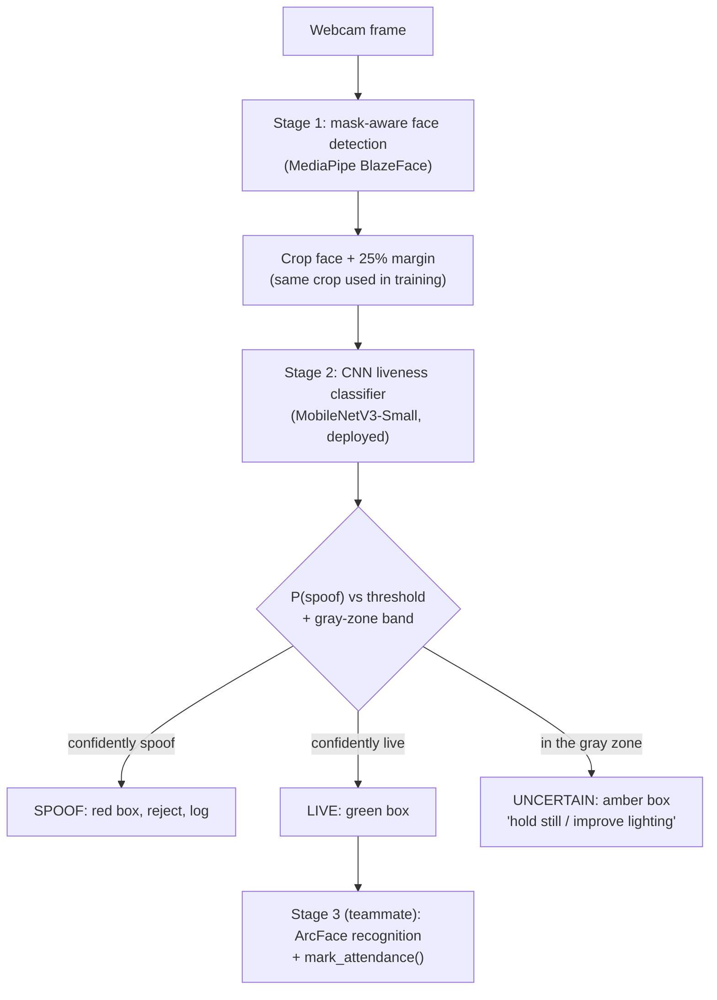

<div align="center">


</div>

## ✨ Overview

A face-attendance system that only asks "is there a face?" can be fooled by a **printed photo** or a **replayed video on a phone screen**. This project puts a **liveness gate** in front of face recognition: a webcam frame is checked for a real, live face — **even when the person wears a mask** — and only faces classified **LIVE** continue to recognition and attendance logging.

The gate has two stages: **(1)** mask-aware face detection with MediaPipe BlazeFace, and **(2)** a fine-tuned CNN (MobileNetV3-Small, with ResNet-18 and EfficientNet-B0 trained and benchmarked for comparison) that outputs **LIVE / SPOOF / UNCERTAIN** — a third, deliberately-undecided state for frames the model isn't confident about, rather than forcing a wrong answer. It is trained on a curated, identity-disjoint subset of **CelebA-Spoof**.

> 🎓 Built as a course project (CSE471: Deep Learning for Computer Vision). Stages 1–2 are implemented here, including a web dashboard (live detection, Grad-CAM explainability, result exploration); the ArcFace recognition + attendance logging stage is a teammate's module, plugged in through a clean integration point.
>
> A real train/deploy mismatch was found and fixed mid-project — see **Results** below for what changed and why the numbers moved.

## 🧭 Pipeline



## 🔑 Key features

| | Feature | Notes |
|---|---|---|
| ✅ | Mask-aware face detection | MediaPipe BlazeFace keeps working with a mask on |
| ✅ | CNN liveness classifier | MobileNetV3-Small (deployed); ResNet-18 and EfficientNet-B0 trained + benchmarked for comparison |
| ✅ | Identity-disjoint data splits | No identity appears in more than one of train/val/test |
| ✅ | Three-way LIVE/SPOOF/UNCERTAIN decision | Gray-zone band selected on validation only, catches most real mistakes as "uncertain" instead of wrong — see below |
| ✅ | Grad-CAM explainability | On-demand heatmap (too slow to run every frame) showing what the model actually looked at |
| ✅ | Synthetic masked-face evaluation | Landmark-based surgical-mask overlay, measures the real masked-vs-unmasked gap |
| ✅ | Web dashboard | Live camera/sample-image detection, results explorer, robustness story, model comparison — `webapp/` |
| ✅ | Evaluation scripts | Accuracy, APCER, BPCER, HTER, confusion matrix, per-attack-type/illumination/environment breakdown |
| ✅ | Real-time webcam pipeline | Decision log written for every accepted/rejected/uncertain frame |
| ✅ | ONNX export + benchmark | All three backbones exported and latency-measured (CPU PyTorch, CPU ONNX Runtime, MPS) |
| ✅ | Classical baseline | Simple OpenCV blur-based baseline for comparison |
| ✅ | Published results | 98.69% accuracy, 1.31% HTER (deployed model, canonical protocol) — see below |
| 🔜 | Real-world webcam evaluation | Script and recording instructions ready (`evaluate_real_world.py`); no footage recorded yet |
| 🔜 | ArcFace + attendance integration | Teammate's module |

## 🧰 Tech stack


## 📈 Results

### The train/deploy crop mismatch (found and fixed mid-project)

The first trained model (**v1**) was trained on raw, full CelebA-Spoof photo frames — but the real deployment pipeline crops tightly to the detected face first. Measured directly: the face occupied a median of just **16.8%** of the raw training frame. Evaluating v1 through the real deployment crop (instead of the raw frame it was trained on) dropped accuracy from 99.15% to **94.54%** (HTER 0.85% → 5.46%) — the number everyone should actually trust, since it's what the live system really does.

**v2** was retrained on face crops built with the exact same BlazeFace-crop function the live pipeline uses, closing almost all of that gap:

| Metric (deployment crops, n=3,900) | v1 (raw-frame-trained) | **v2 (deployed)** |
|---|---|---|
| Accuracy | 94.54% | **98.69%** |
| APCER (spoof accepted as live) | 7.74% | **1.38%** |
| BPCER (live rejected as spoof) | 3.18% | **1.23%** |
| HTER | 5.46% | **1.31%** |

Grad-CAM on the same real false-accept image under both checkpoints shows why: v1's attention sat on the subject's **collar/neck**, v2's sits on the **face** — see the Robustness page in the web dashboard for the actual heatmaps.

### Backbone comparison (identical recipe, all three on the fixed crop)

| Backbone | HTER | File size | CPU (PyTorch) | CPU (ONNX) | MPS |
|---|---|---|---|---|---|
| **MobileNetV3-Small (deployed)** | 1.31% | **3.95MB** | 45.7ms | **2.8ms** | 6.6ms |
| ResNet-18 | 1.10% | 42.96MB | 12.0ms | 17.3ms | 5.9ms |
| EfficientNet-B0 | **0.74%** (most accurate) | 16.21MB | 131.8ms | 7.7ms | 11.0ms |

MobileNetV3-Small isn't the most accurate of the three — EfficientNet-B0 measures a lower HTER — but it's by far the smallest checkpoint and the fastest under ONNX Runtime on CPU, which is why it stays deployed.

### Three-way decision (gray zone)

A validation-selected UNCERTAIN band, applied to the test set, catches most of what the plain threshold gets wrong instead of silently returning a confident wrong answer: **24 of 27** false accepts and **19 of 24** false rejects fall into UNCERTAIN rather than being wrongly decided.

### Masked-face robustness

Synthetic surgical-mask overlays (white / light blue / black, nose-to-chin) on real test images: HTER rises from 0.97% unmasked to 1.57% masked under the same BlazeFace-only methodology — a real but modest gap, not flagged for an immediate retrain.

These numbers come from training on data that was audited and label-corrected against CelebA-Spoof's own official ground truth (2,022 images had their folder-implied label overridden by the authoritative `metas/*.json` label before training). Full detail — including the canonical-protocol definition, per-attack-type/illumination/environment breakdowns, and every number above with its exact measurement protocol — lives in `results/summary.json` (regenerate with `python src/build_summary.py`) and is explorable in the web dashboard (`webapp/`). CASIA-FASD cross-dataset generalization and real-world webcam evaluation have not been run yet (see Roadmap).

Getting the live pipeline working required pinning `mediapipe==0.10.30` — newer builds crash on Apple M4 / Metal 4 (see `requirements.txt`).

## 🚀 Installation & usage

```bash
git clone https://github.com/Yuvika687/anti-spoof-attendance.git
cd anti-spoof-attendance
python3 -m venv venv && source venv/bin/activate   # Windows: venv\Scripts\activate
pip install -r requirements.txt                     # Python 3.9–3.11 recommended (MediaPipe)
```

```bash
# Build an identity-disjoint CelebA-Spoof subset (dataset must be downloaded first)
cd src
python prepare_celeba_subset.py --raw_root /path/to/CelebA_Spoof --out_root ../data/celeba_spoof \
  --live_total 13000 --spoof_total 13000 --train_frac 0.70 --val_frac 0.15 --test_frac 0.15

# Build the face-cropped training set (matches what the live pipeline actually feeds the model --
# see the crop-mismatch story above; train on this, not the raw subset above)
python build_face_cropped_dataset.py --subset_root ../data/celeba_spoof --out_root ../data/celeba_spoof_cropped

# Train
python train.py --data_root ../data/celeba_spoof_cropped --backbone mobilenet_v3_small \
  --epochs 15 --batch_size 32 --lr 3e-4 --image_size 224 --freeze_epochs 2

# Evaluate (test, then validation -- the gray zone needs both), select the
# gray-zone band, build the results summary
python evaluate.py --data_root ../data/celeba_spoof_cropped/test
python evaluate.py --data_root ../data/celeba_spoof_cropped/val --tag val
python evaluate_gray_zone.py
python build_summary.py

# Run the webcam demo, or the web dashboard
python realtime_pipeline.py
cd ../webapp/backend && python app.py   # then open http://localhost:5050
```

> Datasets are **not** included: CelebA-Spoof is research-only (non-commercial) and CASIA-FASD requires requesting access. Both must be obtained from their authors.
>
> ⚠️ **Known limitation, found by auditing the actual download:** the Google
> Drive mirror linked from the official CelebA-Spoof repo turned out to be
> an incomplete copy of the full release — it contains **9,196 identities /
> 561,575 images**, not the paper's published **10,177 identities /
> 625,537 images** (~90% of the full dataset). Our training subset is still
> correctly identity-disjoint and class-balanced within what we have, but
> this repo has not trained on the literal complete CelebA-Spoof release.
> We also found that trusting the `live`/`spoof` *folder name* for labels
> (rather than the dataset's own `metas/*.json` ground truth) mislabels
> 0.36% of images — `prepare_celeba_subset.py` now cross-checks against
> the official labels and corrects this automatically when present.

## 🗂️ Project structure

```
anti-spoof-attendance/
├── data/                       # celeba_spoof/, celeba_spoof_cropped/, casia_fasd/, samples/masked/
├── src/
│   ├── config.py  dataset.py  model.py  train.py  evaluate.py
│   ├── face_utils.py  liveness_infer.py  realtime_pipeline.py
│   ├── prepare_celeba_subset.py  prepare_casia_fasd.py  build_face_cropped_dataset.py
│   ├── evaluate_breakdown.py  evaluate_deployment_crops.py  evaluate_v1_vs_v2.py
│   ├── evaluate_gray_zone.py  evaluate_masked.py  evaluate_real_world.py
│   ├── gradcam.py  generate_gradcam_gallery.py  synthetic_mask.py
│   ├── build_summary.py  benchmark_backbones.py  benchmark_onnx.py  export_onnx.py
│   └── baseline_opencv.py  test_masked_samples.py
├── webapp/
│   ├── backend/app.py          # Flask API: live detect/explain, sample-image demo mode, results data
│   └── frontend/               # vanilla JS (ES modules) dashboard: Live / Results / Robustness / Models
├── tests/                      # unittest suite, run via `python -m unittest discover -s tests`
├── results/                    # summary.json, breakdowns, gray-zone/masked-eval results, Grad-CAM galleries
├── docs/screenshots/           # dashboard screenshots
├── notebooks/demo_analysis.ipynb
├── outputs/                    # plots/, predictions/
├── scripts/resume_celeba_download.sh
├── report_notes.md
└── requirements.txt
```

## 🗺️ Roadmap

- [x] Mask-aware face detection (Stage 1)
- [x] CNN liveness classifier, training + evaluation code (Stage 2)
- [x] Real-time webcam pipeline and decision logging
- [x] Train on the CelebA-Spoof subset and publish real metrics
- [x] Find and fix the train/deploy crop mismatch; retrain and re-publish results
- [x] Three-way LIVE/SPOOF/UNCERTAIN decision with a validation-selected gray zone
- [x] Grad-CAM explainability, synthetic masked-face evaluation
- [x] Backbone comparison (ResNet-18, EfficientNet-B0) + ONNX latency benchmarking
- [x] Web dashboard (live detection, results, robustness, model comparison)
- [ ] Record real-world webcam footage and run `evaluate_real_world.py`
- [ ] Evaluate cross-dataset on CASIA-FASD
- [ ] Integrate with the ArcFace attendance module
- [x] Add a LICENSE and a short model card

## 📄 License & model card

Code is [MIT-licensed](LICENSE). Trained model weights are derived from
CelebA-Spoof (research-only, non-commercial) and inherit that
restriction regardless of the code license — see the note at the bottom
of [`LICENSE`](LICENSE). Model details, intended use, evaluation
numbers, and known limitations are documented in
[`MODEL_CARD.md`](MODEL_CARD.md).

## 🙏 Acknowledgements & references

- **CelebA-Spoof** — Zhang et al., ECCV 2020 · [ZhangYuanhan-AI/CelebA-Spoof](https://github.com/ZhangYuanhan-AI/CelebA-Spoof)
- **CASIA-FASD** — Zhang et al., ICB 2012 (CBSR, CASIA)
- **MediaPipe BlazeFace**, **MobileNetV3**, **EfficientNet**, **ArcFace**

<div align="center">

### 👩‍💻 Author

**Yuvika Malhotra** — [GitHub](https://github.com/Yuvika687) · [LinkedIn](https://linkedin.com/in/yuvika-malhotra) · [Email](mailto:yuvikamalhotra1414@gmail.com)


</div>
